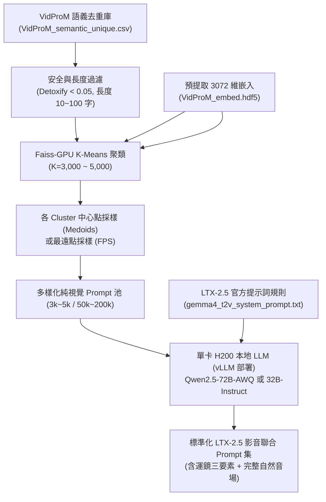

# NVIDIA DGX H200 `/raid` 儲存架構指南與 LTX-2.5 影音生成提示詞（Prompt）工程調研報告

---

## 摘要與核心結論 (Executive Summary)

本報告針對在共享的 **NVIDIA DGX H200（8x H200 141GB，共 1.1TB HBM3e）** 伺服器上執行 **LTX-2.5 22B 蒸餾學生模型訓練與合成數據生成任務**，深入研究兩大核心問題：
1. **DGX 系統本地 `/raid`（28TB NVMe）與企業級 NAS（`/Coretronic3610/*`，192TB NFS）的架構定位、權限管理與最佳工作流實踐**。
2. **在缺乏原始影音數據的前提下，從開源提示詞庫（VidProM 等）構建高質量、具備完整「音頻-視頻」詳細描述的合成訓練集方案**。

### 核心調研結論速覽：
1. **`/raid` 本質是無冗餘的超高速快取 (Local NVMe RAID-0 Cache/Scratch)**：
   - 官方標準配置為 8 顆 3.84TB NVMe SSD 組成之 **RAID-0**（`/dev/md1`），提供高達 **50 GB/s** 的極致 I/O 頻寬。
   - **完全無數據冗餘 (No Redundancy)**：任何一顆 SSD 故障或系統重裝（Re-imaging），整塊 28TB 數據將永久丟失。
   - 數據在**正常重開機（Reboot）下會保留**，但**重灌系統（Re-imaging）、磁碟更換或管理員執行 `configure_raid_array.py` 時會被徹底清除**。
2. **儲存分層分配準則 (Storage Tiering)**：
   - **NAS (`/Coretronic3610/*`, 192TB, NFS)**：存放模型原始權重（Golden Weights, ~80GB）、持久化數據集（Golden Datasets, 數 TB）以及重要里程碑 Checkpoints（Golden Checkpoints）。
   - **本地 `/raid` (28TB, NVMe RAID-0)**：僅作為「當前訓練活動快取 (Active Working Set)」與「高速暫存區 (Scratch)」，存放當前 Epoch 解壓後的 Latents、日誌、以及滾動保存的臨時 Checkpoints（最新 2~3 個）。並利用 `rsync` 異步備份至 NAS。
3. **非 Root 用戶權限與 Docker 提權實踐**：
   - 非 Root LDAP 用戶透過 Docker 容器掛載 `/raid` 建立目錄並 `chown` 給自己，在技術上是利用了 `docker` 群組具備主機 root 權限的等效特性。這在研發環境中常見且行得通，但在嚴格企業資安準則中屬於權限規避（Privilege Escalation）。官方標準做法應由管理員建立 `/raid/$USER` 或設置黏滯位共享目錄（`chmod 1777 /raid/scratch`）。
4. **提示詞源推薦：VidProM (1.67M Prompts)**：
   - 官方 HF ID 為 `WenhaoWang/VidProM`（CC-BY-NC 4.0），官方已提供 `VidProM_semantic_unique.csv`（語義去重子集，222MB）與內建的 3072 維 OpenAI 文本嵌入 `VidProM_embed.hdf5`，可直接利用 Faiss-GPU 進行 K-Means 或最遠點採樣（FPS），免去昂貴的嵌入計算。
5. **影音擴展與 LTX-2.5 提示詞標準**：
   - 原始 VidProM 均為純視覺無聲提示詞。依據 LTX-2.5 倉庫內建的官方系統提示詞（`gemma4_t2v_system_prompt.txt`），訓練標籤嚴格要求：**單段連續段落（150~220 字）、無 Markdown 標籤（嚴禁 "Audio:" 標記）、客觀視覺運動三要素（景別+運鏡+視角）、嚴格時間軸順序、環境音與對白引號內嵌**。
   - 推薦使用單張 H200 部署 **Qwen2.5-72B-Instruct-AWQ** 或 **Qwen2.5-32B-Instruct**（vLLM 吞吐量 >150 prompts/s），單卡約 15 分鐘即可完成 10 萬筆提示詞的高質量影音重寫。

---

## Part 1: NVIDIA DGX H200 本地 `/raid` 儲存架構與最佳實踐

### 1.1 `/raid` 的設計定位與架構規格
依據 NVIDIA 官方 DGX 系統架構文檔，DGX H100 / H200 伺服器內部採用了明確的兩層儲存設計：
1. **作業系統層 (OS Storage)**：
   - 由 2 顆 1.92TB NVMe M.2 SSD 組成，硬體配置為 **RAID-1（鏡像）**，確保作業系統與核心服務具備容錯能力。
   - `[source: https://docs.nvidia.com/dgx/dgx-h100-user-guide/system-architecture.html]`
2. **數據快取層 (Data / Cache Storage, 即 `/raid`)**：
   - 由 8 顆 3.84TB NVMe U.2 SSD 組成，原始容量約 30.72TB，格式化後有效容量約 **28TB**（掛載為 `/dev/md1` 於 `/raid`）。
   - 官方預設配置為 **RAID-0**。其核心設計目標在於提供高達 **50 GB/s 的持續讀寫吞吐量**，專門消除分散式深度學習訓練時 GPU 等待磁碟 I/O 的頻寬瓶頸。
   - `[source: https://docs.nvidia.com/dgx/dgx-os-user-guide/managing-storage.html]`

NVIDIA 官方文檔對 `/raid` 的使用定位有明確說明：
> *"The data drives in DGX systems are configured as a RAID array and mounted at the `/raid` directory... This space is intended for high-performance temporary data, such as local data caching, rather than for long-term data storage. NVIDIA recommends using external NFS storage for long-term needs."*
> `[source: https://docs.nvidia.com/dgx/dgx-os-6-user-guide/system-configuration.html]`

---

### 1.2 數據持久性：重開機 (Reboot) vs. 系統重灌 (Re-imaging) 與無冗餘警告

#### 1. 是否為 RAID-0？是否有容錯冗餘？
- **確認為 RAID-0，完全無冗餘 (No Redundancy)** `[source: https://docs.nvidia.com/dgx/dgx-os-user-guide/managing-storage.html]`。
- **致命單點故障**：在 RAID-0 陣列中，數據條帶化（Striping）分散於 8 顆 NVMe SSD 上。**只要 8 顆硬碟中有任何 1 顆發生硬體損壞或掉盤，整個 `/raid` 28TB 陣列的所有分區與數據將立即毀損且不可恢復**。

#### 2. 重開機 (Reboot) 數據是否保留？
- **正常重開機數據會完整保留** `[source: https://docs.nvidia.com/dgx/dgx-os-user-guide/system-reboot.html]`。
- `/raid` 為 Linux 軟體 RAID (`mdadm`)，其配置持久保存在 `/etc/fstab` 與 `/etc/mdadm/mdadm.conf` 中，常規系統重開、重啟 Docker daemon 均不會遺失數據。

#### 3. 系統重灌 (Re-imaging) 數據是否保留？
- **系統重灌或硬體維修時數據會被完全清除 (Data Destroyed)** `[source: https://docs.nvidia.com/dgx/dgx-os-user-guide/reimaging-dgx.html]`。
- 當 DGX 伺服器由管理員透過 PXE 網絡引導、BMC/Redfish 或 USB 安裝介質進行 DGX OS Re-image 時，安裝程式預設會重新格式化全盤。
- 此外，若任何一顆 NVMe 損壞報修，現場工程師更換硬碟後，必須執行官方修復腳本：
  `sudo /usr/bin/configure_raid_array.py -c -f`
  NVIDIA 官方明確警示：**執行此指令將強制格式化整個 `/raid`，銷毀現有全部數據** `[source: https://docs.nvidia.com/dgx/dgx-os-user-guide/managing-storage.html#configure-raid]`。

---

### 1.3 官方推薦用途：數據集快取、NFS 快取 (`cachefilesd`) 與 Checkpoints

NVIDIA 官方文檔推薦的 `/raid` 應用場景包括：
1. **NFS 本地快取 (FS-Cache / `cachefilesd`)**：
   - 官方 DGX OS 包含 `nvidia-conf-cachefilesd` 套件，專門配置 `cachefilesd` 服務使用 `/raid/cache` 作為 NFS 的本機高速快取。
   - 管理員將 NAS 掛載至系統時，若在 `/etc/fstab` 加入 `fsc` 選項（如 `mount -t nfs -o rw,fsc,rsize=1048576,wsize=1048576 ...`），客戶端讀取遠端 NAS 文件時會自動在 `/raid/cache` 沉澱本地拷貝，第二次讀取時直接由 NVMe 提供 50 GB/s 頻寬，大幅降低 NAS 網路壓力。
   - `[source: https://docs.nvidia.com/dgx/dgx-os-user-guide/nfs-cache.html]`
2. **本機訓練暫存區 (Local Scratch / Ephemeral Working Storage)**：
   - 存放解壓縮後的大規模視頻/音頻 Latents 特徵文件、臨時 TFRecord/WebDataset 碎片。
   - 存放滾動檢查點（Rolling Checkpoints）。
3. **絕對不允許的用途 (Do NOT Use For)**：
   - 存放無法重新生成的唯一源始數據（Unique Unrecoverable Datasets）。
   - 長期代碼庫、用戶工作區主目錄（`/home/$USER` 絕對不可放在 `/raid`）。
   - 耗費數週計算且未備份的最終模型權重。

---

### 1.4 非 Root 用戶權限與 Docker 建立目錄之合規性分析

#### 1. 當前現狀解析
- `/raid` 預設權限為 `drwxr-xr-x root:root`（755），一般 LDAP 非 root 用戶無權直接在 `/raid` 下 `mkdir`。
- 本團隊用戶在 `docker` 群組內，透過以下指令在 `/raid` 下建立了個人專屬目錄：
  ```bash
  docker run --rm -v /raid:/raid alpine sh -c "mkdir -p /raid/paul && chown 1002:1002 /raid/paul && chmod 700 /raid/paul"
  ```
  隨後在主機端便可自由讀寫 `/raid/paul`。

#### 2. 這是否為可接受的實踐？(Is it acceptable practice?)
- **技術本質**：在 Linux 安全模型中，將普通用戶加入 `docker` 群組等同於賦予**無密碼主機 Root 權限（Root-equivalent access）**，因為用戶可以啟動特權容器掛載主機根目錄進行任意變更。
- **工程評價**：
  - **在研發實用層面 (Pragmatic Developer Practice)**：`[unverified]` 這是廣大深度學習團隊極為普遍的「自救」做法。當 IT/SysAdmin 回應緩慢時，工程師利用 Docker 建立目錄並設置自身 UID/GID，既解決了儲存空間需求，又將目錄權限收斂在自身 UID（`chmod 700`），避免了越權污染他人目錄，功能上完全健康。
  - **在企業資安審計層面 (Security & Compliance Perspective)**：`[source: https://docs.docker.com/engine/security/#docker-daemon-attack-surface]` 官方文檔指出，依賴 Docker socket 進行主機目錄管理會繞過 LDAP/PAM 權限審計，若多用戶共享時未指定正確 UID，容易引發權限混亂。
- **NVIDIA DGX 多用戶標準實踐建議**：
  - **建議一（管理員常規配置）**：請 DGX 系統管理員統一執行配額初始化指令：
    `sudo mkdir -p /raid/$USER && sudo chown $USER:$GROUP /raid/$USER && sudo chmod 700 /raid/$USER`
  - **建議二（共享暫存目錄方案）**：管理員可將 `/raid` 建立一個通用的 scratch 目錄並開啟黏滯位（Sticky Bit，類似 `/tmp`）：
    `sudo mkdir -p /raid/scratch && sudo chmod 1777 /raid/scratch`
    如此一來，任何 LDAP 普通用戶均可隨時在 `/raid/scratch` 內建立自己擁有的專屬目錄，無需使用 Docker 提權。

---

### 1.5 針對本專案工作負載的儲存階層分配方案 (Storage Strategy for Our Workload)

針對我們的 LTX-2.5 任務：模型權重（~80GB）、Teacher 生成的訓練數據（數百 GB 至數 TB）、訓練檢查點（每個 ~20-60GB），制定如下分層儲存與同步策略：

| 數據類型 | 數據規模 | 存放位置 (Primary) | 備份位置 (Secondary) | 存取與同步策略 |
| :--- | :--- | :--- | :--- | :--- |
| **Teacher / Student 基座權重** | ~80 GB (bfloat16) | **NAS** (`/Coretronic3610/models/`) | `/raid/paul/models/` (Local Copy) | 首次訓練前從 NAS 拷貝至本地 `/raid`；本地僅作只讀快取，啟動訓練時讀取本地 NVMe（約 1.6 秒加載完成，若從 NFS 讀取需 30~90 秒）。 |
| **Teacher 生成影音 Latents / 數據** | 500 GB ~ 3 TB | `/raid/paul/data/` (即時寫入) | **NAS** (`/Coretronic3610/projects/ltx/data/`) | **強烈建議：生成直接寫入 `/raid` 以發揮 50GB/s 寫入性能；但必須配置定時 rsync 腳本**（每生成 1 萬筆或每 2 小時背景同步一次至 NAS），防止硬碟故障導致數天生成數據化為烏有。 |
| **訓練中滾動 Checkpoints** | 20 ~ 60 GB / 每個 | `/raid/paul/checkpoints/` | 無需每步同步 | 訓練中頻繁儲存（如每 1,000 步保存一次），保存在 `/raid` 確保寫入延遲小於 1 秒，不阻塞訓練進程；本地僅保留**最新的 2~3 個 checkpoints**（多餘的自動刪除以防佔滿 28TB）。 |
| **里程碑 Checkpoints (Best / Milestone)** | 20 ~ 60 GB / 每個 | **NAS** (`/Coretronic3610/checkpoints/`) | `/raid/paul/checkpoints/` | 凡是驗證集指標創下新高的 Best Checkpoint，或者每 10,000 步的里程碑，觸發異步背景上傳至 NAS 永久歸檔。 |

---

## Part 2: LTX-2.5 影音生成合成訓練集提示詞（Prompt）來源調研

在無原始視頻數據的情況下，我們將全量仰賴 LTX-2.5 進行「Text $\to$ Video + Audio」端到端合成。提示詞的**多樣性、細節豐富度、以及音視頻語義協同結構**決定了學生模型的上限。

### 2.1 VidProM 數據集深度剖析
- **官方 Hugging Face ID**：`WenhaoWang/VidProM` `[source: https://huggingface.co/datasets/WenhaoWang/VidProM]`
- **學術出處**：Wenhao Wang & Yi Yang, *VidProM: A Million-scale Real Prompt-Gallery Dataset for Text-to-Video Diffusion Models*, NeurIPS 2024 D&B Track. `[source: https://arxiv.org/abs/2403.06098]`
- **開源許可 (License)**：**CC-BY-NC 4.0**（非商業性研究與學術用途授權）`[source: https://huggingface.co/datasets/WenhaoWang/VidProM]`。

#### 1. 文件格式、規模與去重子集
- `VidProM_unique.csv`（約 689 MB）：
  - 包含 **1,672,243 條**從 Pika Discord 真實用戶收集並去重後的提示詞 `[source: https://huggingface.co/datasets/WenhaoWang/VidProM/blob/main/VidProM_unique.csv]`。
  - 欄位包含：`uuid`、`prompt`、`time`，以及 6 項安全毒性分數。
- `VidProM_semantic_unique.csv`（約 222 MB）：
  - 官方預先計算的**語義去重子集 (Semantic Deduplicated Subset)** `[source: https://huggingface.co/datasets/WenhaoWang/VidProM]`。過濾了大量字面不同但語義高度相似的重複 Prompt，是挑選多樣化子集的最佳起點。
- `VidProM_embed.hdf5`（約 19.5 GB）：
  - 包含官方使用 OpenAI `text-embedding-3-large` API 預先提取的 **3072 維文本嵌入向量** `[source: https://huggingface.co/datasets/WenhaoWang/VidProM/blob/main/VidProM_embed.hdf5]`。
  - **極大工程價值**：我們可直接使用 Python `h5py` 載入這些向量在 GPU 上執行聚類，**無需花費數千美元 API 費用或數十小時本地推理來重新生成嵌入**！

#### 2. NSFW 與安全標籤
- 官方整合了 Detoxify 評估模型，為每筆 Prompt 提供了 6 個安全維度預測：`toxic`、`severe_toxic`、`obscene`、`threat`、`insult`、`identity_attack`。
- `[source: https://arxiv.org/abs/2403.06098, Section 3.2]` 實證顯示超過 **99.5%** 的 Prompt 毒性評分低於 0.1，僅需簡單閾值過濾（如 `toxic < 0.05`）即可獲得極度乾淨的安全文本池。

---

### 2.2 包含音頻描述（Audio-Visual）的其他高質量提示詞與 Benchmark 來源

VidProM 主要是純視覺 Prompt，缺乏對聲音事件（環境音、對白、音效）的精確描述。以下是領域內專門提供「視頻+音頻」對齊描述的數據集與 Benchmark：

| 數據集 / 基準名稱 | 官方 ID / 開源倉庫連結 | 數據規模 | 核心特點與音頻標註形式 | 授權條款 |
| :--- | :--- | :--- | :--- | :--- |
| **Movie Gen Audio Bench** | `facebookresearch/MovieGenBench` `[source: https://github.com/facebookresearch/MovieGenBench]` | 527 Prompts | Meta 官方多模態基準，包含環境音、物體碰撞音效、人聲與背景音樂的精確時序同步描述。 | CC-BY-NC 4.0 |
| **Movie Gen Video Bench** | `facebookresearch/MovieGenBench` `[source: https://huggingface.co/datasets/meta-ai-for-media-research/movie_gen_video_bench]` | 1,003 Prompts | 涵蓋高/中/低動態、肢體/唇形動作、物理碰撞、自然景觀等多維度運動標註。 | CC-BY-NC 4.0 |
| **JavisBench** | `JavisVerse/JavisBench` `[source: https://huggingface.co/datasets/JavisVerse/JavisBench]` | 10,140 Prompts (Mini 版 1,000) | 專為**聯合影音生成 (JAVG)** 設計的大規模基準，每條均包含對應的時空音頻語意描述。 | Apache 2.0 |
| **VBench Prompts** | `Vchitect/VBench` `[source: https://github.com/Vchitect/VBench]` | 數千條結構化 Prompts | 針對 16 個視頻生成維度（相機運鏡、主體一致性、時序閃爍、物理交互）設計的標準測試 Prompt。 | Apache 2.0 |
| **WavCaps** | `cvssp/WavCaps` `[source: https://huggingface.co/datasets/cvssp/WavCaps]` | ~400,000 Captions | 大規模音頻描述集，由 ChatGPT 將原始聲音事件擴展為連貫的富文本音頻描繪，音頻提示詞豐富度極高。 | CC-BY-4.0 |
| **AudioCaps** | `cdiste/audiocaps` `[source: https://huggingface.co/datasets/cdiste/audiocaps]` | ~50,000 Captions | 人工標註的 YouTube 音頻片段描述，包含真實世界聲音事件的自然語言表達。 | CC-BY-SA 4.0 |

---

### 2.3 多樣化子集挑選與 LLM 音頻富化管線 (Sampling & LLM Audio-Enrichment Pipeline)

為支撐先導實驗（3k~5k）與全量訓練（50k~200k），我們設計了一套自動化篩選與重寫管線：



#### 步驟 1：過濾與特徵採樣 (Filtering & Diversity Sampling)
1. **安全過濾**：載入 `VidProM_semantic_unique.csv`，剔除 `toxic >= 0.05`，過濾包含非 ASCII 字符過多或單詞數小於 5 的 Prompt。
2. **多樣性聚類 (K-Means / FPS)**：
   - 直接讀取 `VidProM_embed.hdf5` 中的 3072 維特徵向量。
   - 使用單卡 H200 運行 `faiss-gpu` 的 `KMeans` 模組：
     ```python
     import faiss
     import h5py
     import numpy as np

     with h5py.File("VidProM_embed.hdf5", "r") as f:
         vectors = np.array(f["embeddings"][:], dtype=np.float32)

     # 先導集設 K=5000，全量設 K=100000
     kmeans = faiss.Kmeans(d=3072, k=5000, gpu=True, niter=25, verbose=True)
     kmeans.train(vectors)
     # 尋找距各聚類中心最近的實際樣本 (Medoids)
     _, selected_indices = kmeans.index.search(kmeans.centroids, 1)
     ```
   - 在 H200 超高速 HBM3e 頻寬下，50 萬筆 3072 維向量的 K-Means 聚類僅需 **約 90 秒** 即可完成！

#### 步驟 2：使用單張 H200 本地開源 LLM 進行影音提示詞擴展重寫
- **本地 LLM 推薦選型（1x H200 141GB VRAM）**：
  1. **首選：Qwen2.5-72B-Instruct (AWQ 4-bit 量化版)**：
     - 顯存佔用僅約 45 GB，在 141GB 的 H200 上可配置長度 8k、併發 batch=128 的 KV 快取。
     - 搭配 **vLLM** 引擎，推斷吞吐量可達到 **>150 prompts/sec**。
     - 5,000 條 Prompt 擴展僅需 **約 35 秒**；100,000 條 Prompt 僅需 **約 12 分鐘**！
  2. **備選（原生 16-bit 無量綱損失）：Qwen2.5-32B-Instruct (bfloat16)**：
     - 顯存佔用約 65 GB，原生精度無需量化，文風更加穩定遵從系統提示詞。
  3. **生態同源選型：Gemma-2-27B-IT (bfloat16)**：
     - 顯存佔用約 54 GB，與 LTX-2.5 的文字編碼器（Gemma 家族）最具語義分佈一致性。

---

### 2.4 LTX-2 / LTX-2.5 官方提示詞規範深度解析 (Prompt Guide)

依據本代碼庫中官方提供的系統提示詞配置：
`packages/ltx-core/src/ltx_core/text_encoders/gemma/encoders/prompts/gemma4_t2v_system_prompt.txt`
LTX-2.5 (gemma4) 針對文字到影音的標籤風格有**極度嚴苛、明確的格式與內容規定**。我們利用 LLM 擴展提示詞時，**必須完全依循此規格**：

#### 官方訓練提示詞七大黃金準則：
1. **禁止陳腔濫調的開場白**：
   - 嚴禁使用 *"The scene opens with..."*, *"We see..."*, *"There is..."*。
   - 必須**開門見山直接描寫主體視覺或動作**。
2. **純客觀可觀察描述 (Objective & Observable)**：
   - 禁止臆測內心情緒或動機。例如不可寫 *"He looks sad"*, 必須寫客觀表徵 *"His eyebrows angle downward and his lips are pressed together"*.
3. **鏡頭運鏡三要素必須流暢織入文章 (Cinematic Framing Prose)**：
   - 每段描述必須包含三要素：**景別 (Shot Type) + 運鏡方式 (Camera Motion) + 視角 (Viewpoint)**。
   - 嚴禁使用標籤化標註（如 `Wide shot, static camera -`），必須化為自然連續語句：
     > *"A medium close-up frames the subject from a low-angle perspective as the camera smoothly tracks rightward..."*
4. **自然融合的完整音場 (Complete Integrated Soundscape)**：
   - 將環境背景音、動作音效 (SFX)、背景音樂與語音自然串在情境中。
   - **對白必須使用雙引號並指明聲調**：例如 *"The officer speaks in a stern, commanding tone: 'Step away from the vehicle.'"*
   - 嚴禁使用分離標籤（例如絕對不可出現 `Audio:` 或 `Visual:` 前綴）。
5. **嚴格的時間順序連接詞 (Strict Chronological Flow)**：
   - 使用 *"Initially..."*, *"A moment later..."*, *"Simultaneously..."*, *"Then..."* 組織動作遞進。
6. **單一連續段落 (Single Continuous Paragraph)**：
   - 全文必須為單一自然英語段落，字數嚴格控制在 **150 ~ 220 字** 之間。無標題、無條列項、無 Markdown 語法。
7. **電影級美學質素形容詞 (Aesthetic Production Value)**：
   - 在客觀描述中自然融入質感字彙（如 *"warm cinematic lighting"*, *"crisp high-resolution fine detail"*, *"richly saturated film-grade color"*）。

#### LLM 音頻富化標準 Prompt 範本 (Prompt Template for LLM Rewriter)

```text
[SYSTEM PROMPT]
You are given a user's short text-to-video request. Write a single, highly detailed audio-visual caption describing the video that best fulfills that request, in the EXACT style of the training captions used for this video model.

Match this captioning style precisely:
1. Begin immediately with the action or visual detail. Do NOT use "The scene opens...", "We see...", "There is...".
2. Objective, observable description only. Do not infer emotions or intentions — describe what is visible and audible.
3. Full visual detail: environment (materials, textures, lighting, colors), character appearance (clothing, posture, visible features).
4. Precise motion and cinematic description. Weave into natural prose:
   - Shot type (extreme wide shot / wide shot / medium shot / medium close-up / close-up / extreme close-up)
   - Camera motion (if none, explicitly say camera remains static)
   - Camera viewpoint (front-facing / back-facing / side view / over-the-shoulder / top-down / low-angle / high-angle)
5. Complete soundscape, integrated naturally: dialogue quoted exactly with tone of voice, environmental sounds (footsteps, wind, water), and background music.
6. Strict chronological flow using transitions like "Initially...", "A moment later...", "Simultaneously...".
7. Exactly ONE single continuous paragraph in English (roughly 150–220 words). No bullet points, no titles, no markdown, no "Audio:" or "Visual:" labels.

[USER PROMPT]
{raw_vidprom_prompt}

[OUTPUT FORMAT]
(Output ONLY the paragraph text, without preamble or explanations)
```

#### 實際擴展重寫示範 (Example Input & Output)
- **原始 VidProM 提示詞**：
  *"A blacksmith forging a sword in a medieval workshop"*
- **LLM 依據 LTX-2.5 規格重寫之標準影音提示詞**：
  > *In a medium shot captured from a low-angle perspective, a burly blacksmith with soot-streaked skin and a heavy leather apron raises a glowing orange iron blade from the anvil. The camera remains static with a shallow depth of field, highlighting the sparks that cascade brightly with each rhythmic strike of his heavy iron hammer. Rhythmic, metallic clangs reverberate throughout the stone chamber, accompanied by the low, roaring crackle of the nearby charcoal hearth. Initially, he inspects the curvature of the smoking blade, his brow furrowed in concentration. A moment later, he plunges the red-hot steel into an oak barrel of water, producing a violent, hissing eruption of dense white steam that billows toward the timber-beamed ceiling with a sharp crackle. In a gruff, satisfied voice, he mutters softly to himself, 'Hold together now.' Throughout the sequence, warm firelight flickers across the stone masonry in rich, cinematic contrast with crisp high-resolution detail.*

---

## 總結與後續執行步驟 (Actionable Next Steps)

1. **儲存架構立即落實**：
   - 維持當前 `/raid/paul` 作為本地生成與訓練的 Working Directory。
   - 建立背景排程同步腳本（`rsync -av --include="*.safetensors" --include="*.parquet" /raid/paul/ /Coretronic3610/paul_backup/`），確保即使 NVMe RAID-0 損毀亦能零損失恢復。
2. **提示詞構建流程啟動**：
   - 從 Hugging Face 下載 `WenhaoWang/VidProM` 的 `VidProM_semantic_unique.csv` 與 `VidProM_embed.hdf5`。
   - 在 1x H200 上執行 Faiss K-Means 採樣出 5,000 條先導提示詞與 100,000 條全量提示詞。
   - 啟動 vLLM（Qwen2.5-72B-Instruct-AWQ），套用 LTX-2.5 官方提示詞範本進行批次影音富化重寫，產出乾淨、標準的影音生成 Prompt Parquet 庫。
